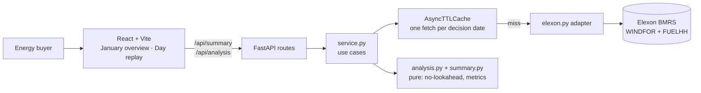

# Wind decision replay

A January 2026 pilot for a UK energy buyer's day-ahead desk. The app shows two things:

1. **The forecast that was actually available** when a day-ahead buying decision was made, i.e. the latest Elexon wind forecast published by the decision cutoff, for each delivery hour.
2. **How wrong that forecast turned out to be**, both for one day and across every January decision date. The error is quantified as MAE, bias, RMSE, the error distribution (P10/P50/P90) and the pattern by hour of day.

React (TypeScript, Vite) is the frontend. Python (FastAPI) owns Elexon access, forecast selection and all calculations.

**Deployed app:** https://kjwhrhsz.vercel.app/ · **Demo video:** https://www.youtube.com/watch?v=O7sgtcqmjBE

## Architecture



More diagrams are in [docs/architecture.md](docs/architecture.md): backend layers, frontend structure, request sequence, forecast selection, cutoff timeline, caching and deployment.

## What the client sees

- **January overview** (default view): month-wide accuracy for the chosen cutoff, with:
  - a plain-language note on what that error means for buying
  - daily MAE bars; click a bar to replay that day
  - average bias by delivery hour
- **Day replay**: the decision-time forecast against the actual outturn for one delivery day, plus an audit table with the publish time of every forecast used.

### Key analytical choices

| Choice | Detail |
| --- | --- |
| Decision cutoff | Default **09:00 UK time**: the last whole hour before the GB day-ahead hourly auctions close (EPEX 09:20, N2EX 09:50). 15:00 matches the EPEX 15:30 half-hourly auction. Any whole hour can be selected. In January, UK time equals UTC. |
| Delivery day | The calendar day after the decision date, so 31 January decisions cover 1 February delivery. |
| Forecast selection | For each delivery hour, the WINDFOR row with the latest `publishTime` at or before the cutoff. Later revisions can never leak in. |
| Time alignment | WINDFOR is hourly and FUELHH is half-hourly. Each hourly forecast is compared with the mean of the two FUELHH `WIND` half-hours in that hour. If either half is missing, the hour is left unscored. |
| Error | Forecast minus actual, in MW, so positive bias means wind was overestimated. |
| Missing data | Shown as missing and counted in coverage. It is never filled in or scored as zero. |

### Finding to raise with the client

At the 09:00 cutoff, January MAE is about 2.0 GW, which is 18% of mean wind output. Bias is about +1.75 GW, so most of the miss is a persistent offset. The remaining hour-to-hour uncertainty is about ±1.8 GW (one standard deviation).

Elexon's WINDFOR covers wind farms with operational metering, while FUELHH reports outturn by fuel type, so the two may not describe the same fleet. The offset should be confirmed with the client before any correction is applied. The pilot uses only these two datasets, so it does not calculate a purchase volume, which would need demand and other supply data.

## Repository layout

| Path | Purpose |
| --- | --- |
| `backend/app/main.py` | FastAPI app: CORS and router registration |
| `backend/app/routes.py` | HTTP layer: `/api/health`, `/api/analysis`, `/api/summary`; validation, error mapping and cache headers |
| `backend/app/service.py` | Use-case orchestration: pilot date range, default cutoff, single-day and month-wide analysis |
| `backend/app/elexon.py` | Elexon HTTP adapter (WINDFOR, FUELHH), retry, and the cached day provider |
| `backend/app/cache.py` | In-process async TTL cache that shares in-flight loads and never caches failures |
| `backend/app/analysis.py` | Pure domain logic for one day: no-lookahead selection, alignment and metrics |
| `backend/app/summary.py` | Pure month aggregation: pooled metrics, percentiles, by-hour and by-day breakdowns |
| `backend/app/schemas.py` | Pydantic response contracts, published through OpenAPI at `/docs` |
| `vercel.json`, `backend/index.py` | Vercel config (one project, FastAPI + Vite services) and the backend entry point |
| `backend/scripts/verify_january.py` | Opt-in live check of every January decision date; writes `docs/evidence/` |
| `backend/tests/` | Unit and API tests (no network) |
| `frontend/src/features/wind-replay/` | Page, components, API calls, query hooks, types and formatting |
| `frontend/src/lib/` | Shared HTTP client and TanStack Query configuration |
| `frontend/nginx.conf`, `*/Dockerfile`, `compose.yaml` | Container build; Nginx serves the bundle and proxies `/api` |
| `docs/architecture.md` | Design, data flow and caching |
| `docs/demo-script.md` | Outline for the two-part video |
| `.github/workflows/verify.yml` | CI: backend tests and frontend type-check and build |

## API

| Endpoint | Parameters | Returns |
| --- | --- | --- |
| `GET /api/analysis` | `decision_date` (2026-01-01 to 2026-01-31), `cutoff_hour` (0–23, default 9) | 24 hourly periods with the forecast used, its publish time, actual, error, coverage and warnings |
| `GET /api/summary` | `cutoff_hour` (0–23, default 9) | January-wide metrics, error percentiles, bias-corrected spread, by-hour and by-day metrics |

## Run with Docker

```sh
docker compose up --build
```

Open `http://localhost:8080`. The backend fetches Elexon data at request time, so the containers need internet access. No API key is required.

## Run without Docker

Backend (Python 3.12+):

```sh
cd backend
python -m venv .venv
.venv/bin/python -m pip install -r requirements-dev.txt     # Windows: .venv\Scripts\python
.venv/bin/python -m uvicorn app.main:app --reload
```

Frontend (Node 22), in a second terminal:

```sh
cd frontend
npm install
npm run dev
```

Open `http://localhost:5173`. Vite proxies `/api` to port 8000.

## Tests

```sh
cd backend && python -m pytest tests -q
cd frontend && npm run build    # TypeScript type-check and production build
```

The backend tests cover:
- the no-lookahead rule, including exact equality at the cutoff
- half-hour alignment
- missing data, conflicting revisions and invalid values
- percentile and month aggregation
- cache behaviour: shared in-flight loads, expiry, failures not cached, eviction
- partial Elexon failure in the month summary
- the API's validation and error contract

To check against live Elexon data, run `python -m scripts.verify_january` from `backend`. The latest run matched 744 of 744 delivery hours at 09:00; see `docs/evidence/january-live-check.json`.

## Caching and performance

January 2026 data does not change, so one Elexon fetch per decision date is cached in memory and reused for every cutoff hour. The cache defaults to 6 hours and can be set with `ELEXON_CACHE_TTL_SECONDS`.

- A cold month summary makes 62 Elexon calls, 4 dates at a time, and took about 15 s in local testing.
- Later summaries, and day views within the cached month, return in well under a second.

Successful responses also send `Cache-Control: s-maxage=86400`, so the Vercel CDN can serve repeat requests without a cold function. A summary with failed days is not edge-cached.

## Deploy on Vercel

The root `vercel.json` deploys everything as **one Vercel project** using two services:
- `backend` (FastAPI) receives `/api/*`.
- `frontend` (Vite) serves everything else.

Both are on the same domain, so no CORS setup or API URL variable is needed.

1. In Vercel, go to **Add New → Project** and import the repository. Leave **Root Directory** as the repository root.
2. Click **Deploy**.
3. Check `https://<your-app>.vercel.app/api/health`, which should return `{"status":"ok"}`. Then open the app itself.

## Limitations

- **Scope.** Only January 2026 decisions are supported. Supporting a wider range would need UK daylight-saving handling, since cutoffs are whole UTC hours.
- **Alignment.** Comparing an hourly forecast with the mean of two half-hours is an assumption to confirm with the client.
- **Hindsight.** Accuracy statistics are retrospective, and one month of history is a small sample for setting a buying policy.
- **Coverage gap.** WINDFOR and FUELHH may not cover an identical wind fleet (see the finding above).

## AI tools

AI assistants were used throughout:
- **OpenAI ChatGPT/Codex** helped design and implement the application, tests and documentation.
- **Claude Code (Anthropic)** reviewed the architecture and added the January summary analysis, caching and documentation updates.

All analytical assumptions were reviewed by the author.

## Sources

- [Elexon FUELHH stream](https://bmrs.elexon.co.uk/api-documentation/endpoint/datasets/FUELHH/stream)
- [Elexon WINDFOR stream](https://bmrs.elexon.co.uk/api-documentation/endpoint/datasets/WINDFOR/stream)
- [Elexon wind generation methodology](https://bmrs.elexon.co.uk/wind-generation)
- [Nord Pool: about the GB day-ahead auction](https://support.nordpoolgroup.com/support/solutions/articles/8000088463-about-the-day-ahead-gb-auction)
