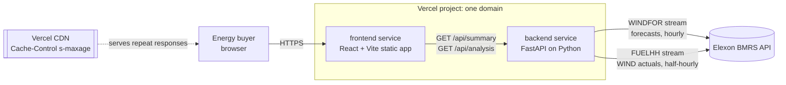
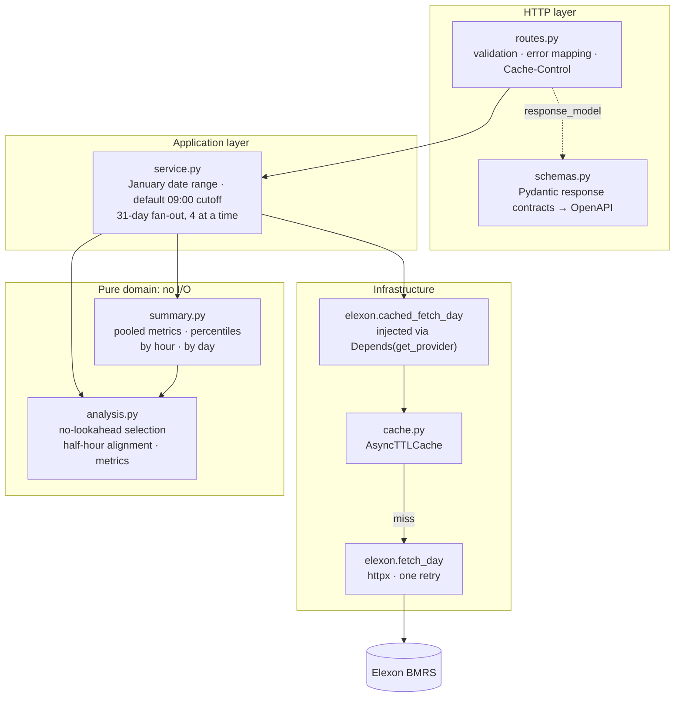
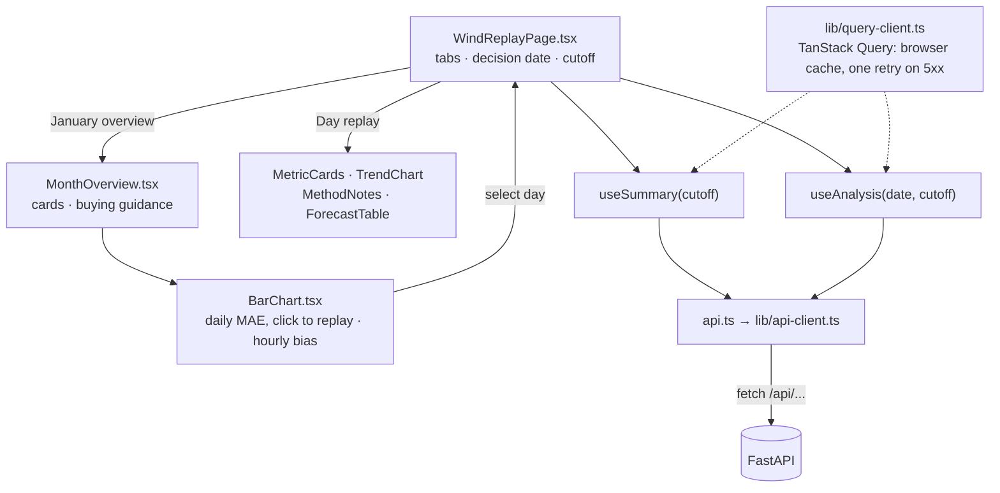
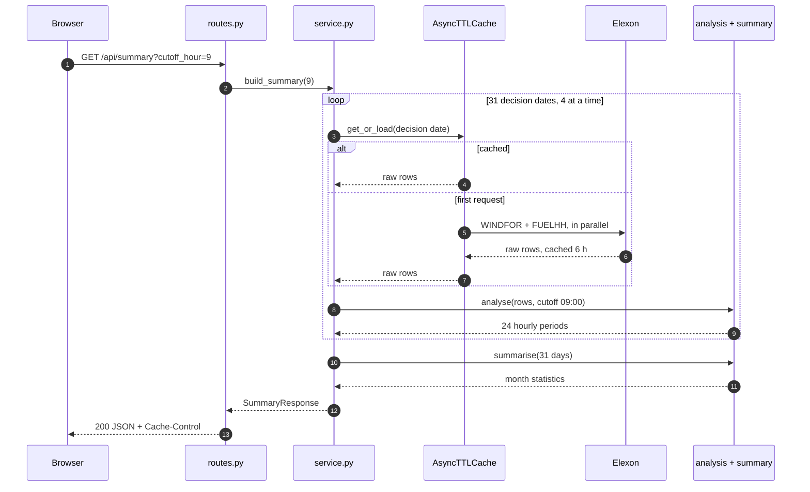
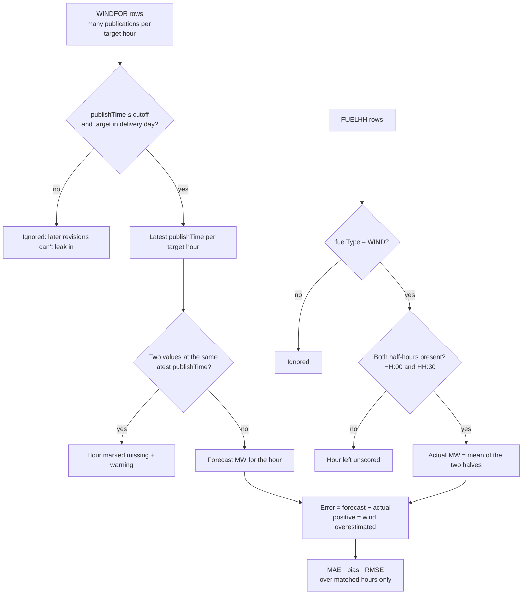
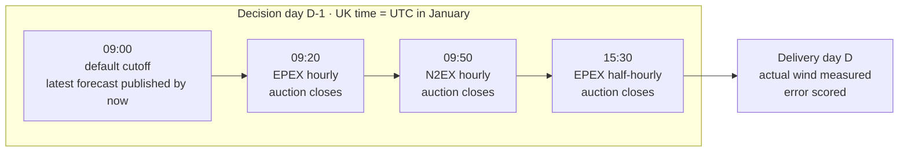
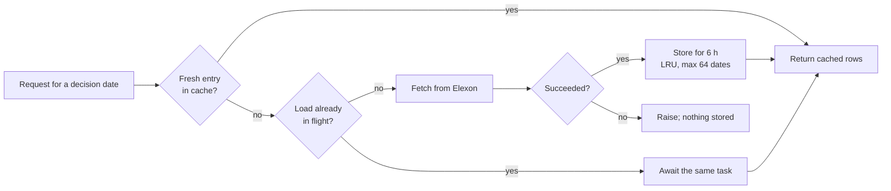
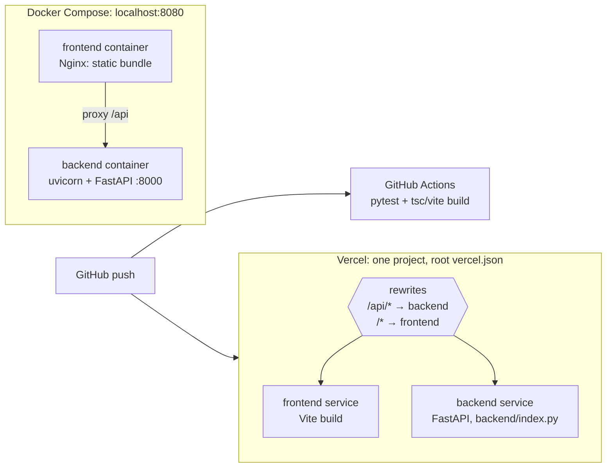

# Architecture and analytical contract

## System overview

Everything is read-only, public data. There is no database or authentication. Elexon is the only source of truth, and the backend fetches it on demand and caches it.

## Backend layers

Dependencies point inward:
- The domain modules (`analysis.py`, `summary.py`) have no HTTP or I/O code and are tested with small in-memory records.
- The routes receive the data provider through FastAPI dependency injection, so API tests swap in a fake provider and never touch the network.
- A single Python service is enough for this read-only pilot. Splitting it into separate services would add operational cost without any benefit.

## Frontend structure

## Request flow: January overview

**Day replay** (`/api/analysis`) follows the same path for one decision date, without the loop or `summarise()`.

If Elexon fails for some dates, those dates are excluded and named in a warning, and the response is not edge-cached. The request fails with a 502 only if every date fails.

## Forecast selection and alignment

Rules behind the diagram:
1. All timestamps are parsed as UTC.
2. Input order never decides between conflicting values.
3. Missing data is reported as missing and counted in coverage; it is never scored as zero error.

Month statistics are recomputed from unrounded forecast and actual values:
- pooled MAE, bias and RMSE, and MAE as a percentage of mean actual output
- signed error percentiles (P10, P50, P90): P90 is the shortfall band a buyer may want covered by other supply
- absolute-error percentiles
- the standard deviation of the error (the uncertainty left once the persistent bias is removed)
- by-hour and by-day breakdowns

## Decision cutoff

The default cutoff is 09:00, the last whole hour before the hourly gate closures. The user can choose any whole hour.

All supported decisions are in January, so UK time equals UTC for every decision and delivery timestamp. Supporting a wider date range would require explicit daylight-saving handling.

## Caching

- **One fetch serves all cutoffs.** `elexon.fetch_day` reads WINDFOR publications through the end of the decision day, and the domain layer applies the exact cutoff. So one cached fetch per decision date serves all 24 cutoff hours.
- **Configurable expiry.** Set `ELEXON_CACHE_TTL_SECONDS` to change the default of 6 hours.
- **HTTP cache.** Successful responses carry `Cache-Control: public, max-age=300, s-maxage=86400, stale-while-revalidate=86400`.
  - Vercel's CDN can then serve repeat requests without invoking a serverless function. This matters because the in-process cache does not survive cold starts.
  - A summary with failed days is not edge-cached, so it is retried promptly.
- **Measured locally:**
  - A cold month makes 62 Elexon calls and takes about 15 s.
  - After that, any cutoff takes under 1 s.

## Deployment

Both setups serve the frontend and the API from one origin, so the frontend always calls a relative `/api` path and no CORS configuration is needed. `FRONTEND_ORIGIN` and `VITE_API_BASE_URL` are only needed if the backend is ever hosted on a separate domain.

## Data interpretation

This is an operational comparison rather than a formal benchmark of the forecasting model:
- WINDFOR forecasts wind farms with operational metering; FUELHH reports national outturn by fuel type. Their coverage can differ.
- In January 2026 the forecast sits on average about 1.75 GW above FUELHH. That offset should be explained before it is corrected.
- Demand and other supply are out of scope, so the pilot does not calculate a purchase quantity.
